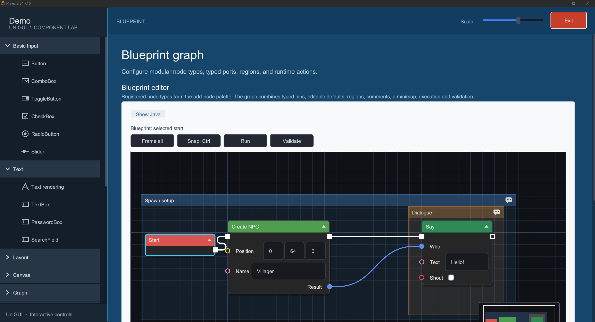
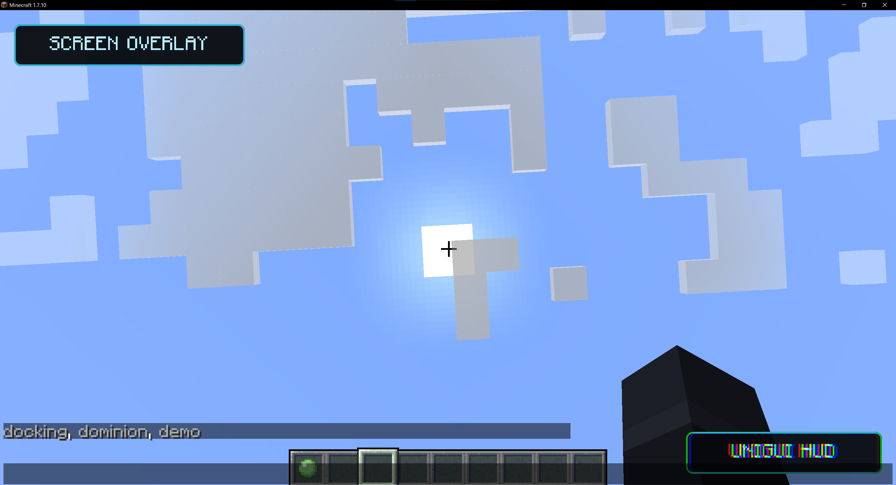
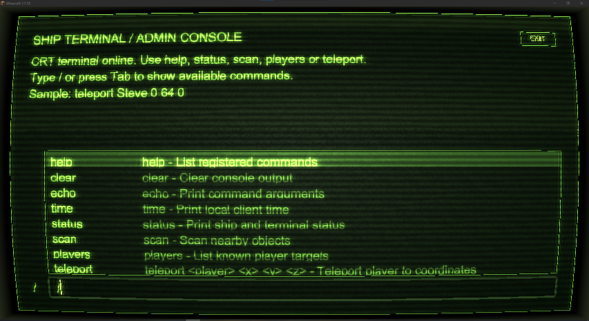
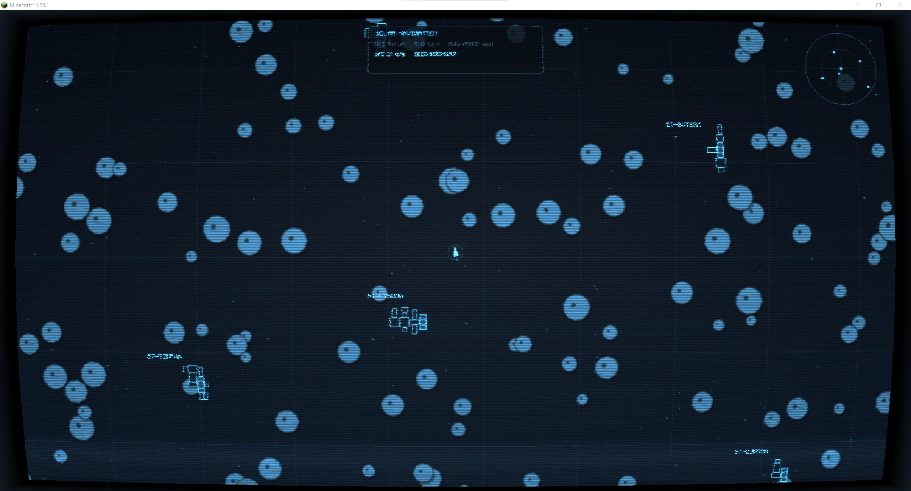
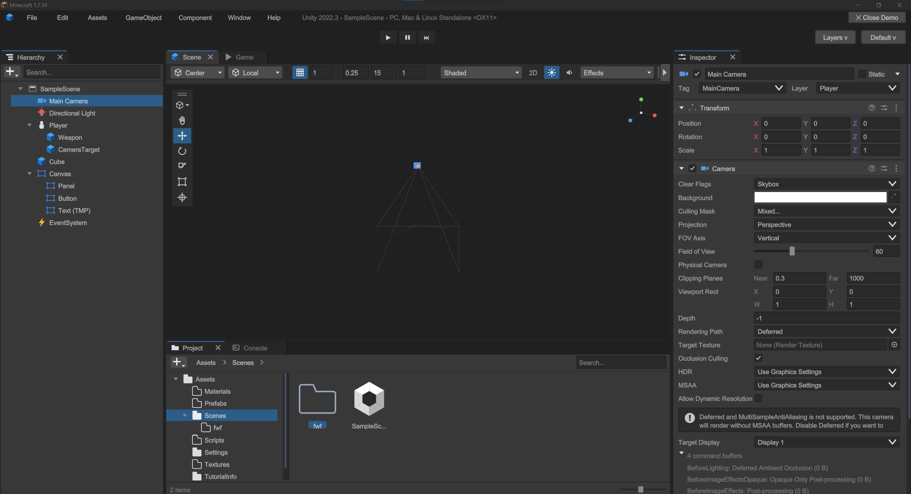

<p align="center">
  
</p>

<h1 align="center">UniGUI</h1>

<p align="center">
  A retained-mode UI toolkit for Minecraft mods.<br>
  Build interfaces from widgets, then render them in screens, overlays, and HUD layers.
</p>

<p align="center">
  
  
</p>

<p align="center">
  <a href="https://www.curseforge.com/minecraft/mc-mods/uni-gui"></a>
  <a href="https://modrinth.com/mod/uni-gui"></a>
</p>

<p align="center">
  <a href="https://jitpack.io/#DeusSixik/UniGui"></a>
  <a href="https://www.gnu.org/licenses/lgpl-3.0.html"></a>
  <a href="https://deussixik.github.io/UniGUI/"></a>
</p>

<p align="center">
  <a href="https://discord.gg/TEUrpKJynj"></a>
</p>

UniGUI is a Java UI library for building custom interfaces in Minecraft mods. Instead of drawing each control by hand,
you compose a retained widget tree: UniGUI handles layout, input, focus, and drawing, while your mod defines the screen
and behavior. The shared `core` module contains the UI logic; version-specific backends connect it to Minecraft
rendering and input.

The library includes common controls and layout containers, text and data widgets, menus and overlays, plus larger
components such as docking workspaces, node graphs, map canvases, and a code editor. It also provides Minecraft-specific
widgets for item, block, and entity previews, item and texture pickers, and vanilla tooltips. Their available data and
behavior can differ slightly between Minecraft versions to match each version's APIs.

UniGUI renders inside Minecraft's render context and uses the game's rendering pipeline. This keeps its drawing
integrated with Minecraft and avoids the compatibility problems that can come from rendering through a separate
graphics context. The same widgets can be used in standalone screens, over existing Minecraft screens, or as
interactive HUD elements.

## Showcase

### In-game widget demo

Explore the widget catalog in a live Minecraft screen. In the demo client, run `/unigui` to open it.

<div align="center">
  
  <p><em>UniGUI widget demo running in Minecraft</em></p>
</div>

### Screen and HUD overlays

UniGUI can render natively across Minecraft's render layers. Use it to build a complete `UniScreen`, add interactive
overlays to existing Minecraft screens, or draw HUD elements. Input continues to work through the UniGUI widgets in each
of these contexts.

<div align="center">
  
  <p><em>UniGUI screen and HUD overlays in Minecraft</em></p>
</div>

### Retro terminal

A terminal interface inspired by classic DOS consoles, built with UniGUI widgets.

<div align="center">
  
  <p><em>Retro terminal interface</em></p>
</div>

### Solar navigation

A small spacecraft navigation game with a map, markers, and cockpit-style panels.

<div align="center">
  
  <p><em>Solar navigation game interface</em></p>
</div>

### Unity UI port

A partial recreation of the Unity interface, demonstrating how UniGUI can support structurally complex model interfaces.

<div align="center">
  
  <p><em>Unity-inspired interface built with UniGUI</em></p>
</div>

## Use it in a mod

UniGUI's widget tree, layout, input, and draw-command APIs live in the Minecraft-independent `core` module. The
Minecraft-specific modules provide rendering and platform integration for their respective versions and loaders. For
Minecraft 1.7.10 and 1.12.2, add `core`. For Minecraft 1.18 and newer, add both `core` and the matching version of
`common`; add the loader backend for your platform as well.

Artifacts are available from [JitPack](https://jitpack.io/#DeusSixik/UniGui). Add JitPack to your repositories and use
the same UniGUI release tag for each module. For example, for Minecraft 1.21.1:

```groovy
repositories {
    maven { url = uri("https://jitpack.io") }
}

dependencies {
    implementation "com.github.DeusSixik.UniGui:unigui-core:<TAG>"
    implementation "com.github.DeusSixik.UniGui:unigui-common-1.21.1:<TAG>"
}
```

Replace `<TAG>` with the release tag you want to use. For 1.7.10 and 1.12.2, keep only the `unigui-core` dependency;
for other 1.18+ versions, use the matching `unigui-common-<minecraft-version>` artifact. Check the [JitPack project
page](https://jitpack.io/#DeusSixik/UniGui) for available builds and platform backend artifacts.

When developing inside a checkout of UniGUI, depend on the shared module directly:

```groovy
dependencies {
    implementation project(':core')
}
```

For a Minecraft mod, also add the platform backend that matches its Minecraft version and loader. The 1.7.10 and 1.12.2
integrations are GTNH and Cleanroom builds respectively; they are not generic Forge artifacts.

| Minecraft | Module / platform projects              | Notes                                             |
|-----------|-----------------------------------------|---------------------------------------------------|
| 1.7.10    | `1.7.10-gtnh`                           | GTNH-based build; requires Java 21 or newer.      |
| 1.12.2    | `1.12.2-cleanroom`                      | Cleanroom-based build.                            |
| 1.20.1    | `common`, `fabric`, `forge`             | Stonecutter profile; Fabric and Forge.            |
| 1.21.1    | `common`, `fabric`, `forge`, `neoforge` | Stonecutter profile; Fabric, Forge, and NeoForge. |

The legacy 1.7.10 and 1.12.2 projects consume the `core` and `demo` jars from the repository build. When working from
source, build those modules first, then build the corresponding legacy project.

## Layout

```text
core/                  Minecraft-independent widget, layout, input, and rendering APIs
demo/                  Reusable demo screens and examples built on core
common/                Minecraft integration shared by the modern version profiles
fabric/ forge/          Fabric and Forge platform entrypoints
neoforge/              NeoForge platform entrypoint (1.21.1)
TestMod/                Modern Fabric sandbox and in-game demo
1.7.10-gtnh/            GTNH 1.7.10 backend and integration
1.12.2-cleanroom/       Cleanroom 1.12.2 backend and integration
docs/                   Documentation sources and UI images
```

The modern Minecraft projects use [Stonecutter](https://stonecutter.kikugie.dev/). For example, build the 1.21.1 Fabric
sandbox with:

```powershell
.\gradlew.bat :1.21.1:TestMod:runClient
```

The demo client exposes the widget catalog and examples in game. Documentation for the generated API wiki is in [
`docs/wiki-generation.md`](docs/wiki-generation.md).

## License

[LGPL-3.0](LICENSE)
